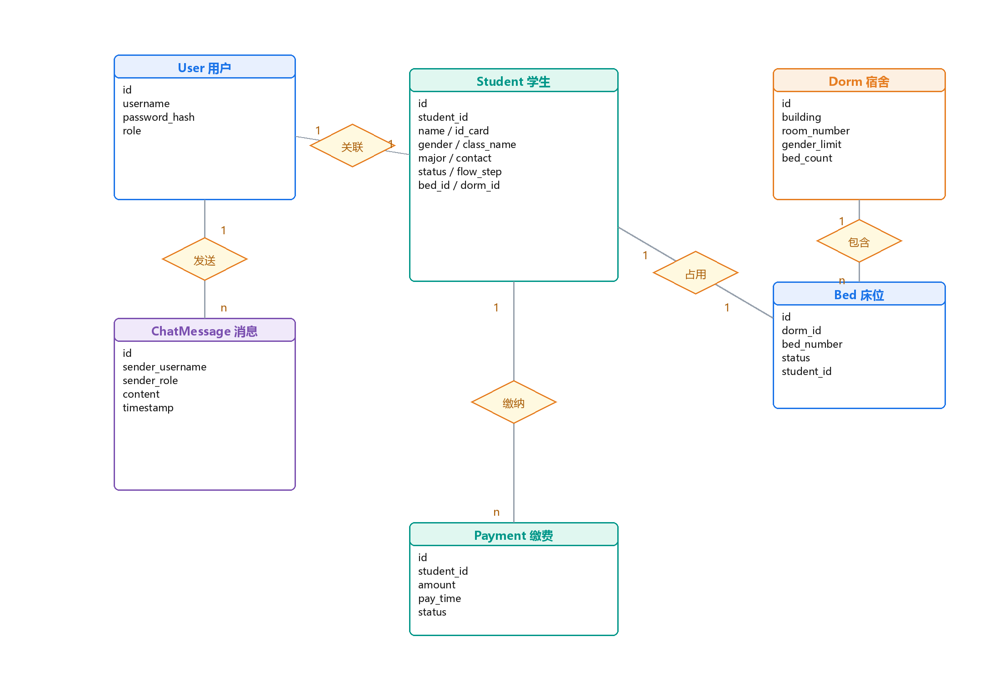

# 数据库设计

系统使用 SQLite 存储业务数据，共 6 张表：`user`、`student`、`dorm`、`bed`、`payment`、`chat_message`。表结构定义位于 [`database.py`](../database.py) 的 `init_db()`，演示数据由 [`seed_data.py`](../seed_data.py) 生成。

## 1 E-R 关系



数据模型围绕“学生—宿舍—床位—缴费”主线展开，实体联系可归纳为三类：

1. **账号与档案**：`user` 与 `student` 通过学号关联。用户表保存登录凭据与角色，学生表保存业务数据，两者分离使认证逻辑与业务逻辑互不干扰，也避免在同一张表中混放凭据与隐私字段。
2. **宿舍资源层级**：`dorm` 与 `bed` 是一对多的包含关系（一个宿舍包含 4 个床位）；`student` 与 `bed` 是一对一的占用关系——一个学生当前只能占用一个床位，一个床位在同一时刻也只能被一个学生占用，这一约束是并发选床控制的依据。
3. **业务记录**：`student` 与 `payment` 是一对多关系，一个学生可以产生多条缴费记录，系统在推进流程时只关心最新缴费状态；`user` 与 `chat_message` 同样是一对多关系。

此外，`student` 表冗余保存 `bed_id` 与 `dorm_id` 两个外键，用于在不联表查询的情况下快速获得学生当前住宿位置。

## 2 表结构

### 2.1 用户表（user）

| 字段名 | 数据类型 | 约束条件 | 说明 |
| --- | --- | --- | --- |
| id | INTEGER | 主键，自增 | 用户唯一标识 |
| username | TEXT | 非空，唯一 | 登录用户名，学生用户即学号 |
| password_hash | TEXT | 非空 | 加盐哈希后的口令 |
| role | TEXT | 默认 `student` | 角色：student / counselor / admin |

### 2.2 学生信息表（student）

| 字段名 | 数据类型 | 约束条件 | 说明 |
| --- | --- | --- | --- |
| id | INTEGER | 主键，自增 | 内部唯一标识 |
| student_id | TEXT | 非空，唯一 | 学号，同时作为登录用户名 |
| name | TEXT | — | 姓名 |
| id_card | TEXT | — | 身份证号码 |
| gender | TEXT | — | 性别（男 / 女），用于宿舍筛选 |
| class_name | TEXT | — | 班级名称，辅导员据此过滤数据 |
| major | TEXT | — | 专业名称 |
| contact | TEXT | — | 联系电话 |
| status | TEXT | 默认 `submitted` | 审核状态：submitted / rejected |
| dorm_id | INTEGER | 外键，可空 | 冗余字段，便于住宿信息查询 |
| bed_id | INTEGER | 外键，可空 | 关联床位表 |
| flow_step | INTEGER | 默认 1 | 当前报到进度（1~5） |

### 2.3 宿舍表（dorm）

| 字段名 | 数据类型 | 约束条件 | 说明 |
| --- | --- | --- | --- |
| id | INTEGER | 主键，自增 | 宿舍唯一标识 |
| building | TEXT | 非空 | 楼栋名称，如“1栋” |
| room_number | TEXT | 非空 | 房间号 |
| gender_limit | TEXT | — | 性别限制（男 / 女 / 不限） |
| bed_count | INTEGER | 默认 4 | 房间床位数 |

### 2.4 床位表（bed）

| 字段名 | 数据类型 | 约束条件 | 说明 |
| --- | --- | --- | --- |
| id | INTEGER | 主键，自增 | 床位唯一标识 |
| dorm_id | INTEGER | 非空，外键 | 所属宿舍 |
| bed_number | TEXT | 非空 | 床位编号，如“1床” |
| status | TEXT | 默认 `free` | 状态：free 空闲 / occupied 占用 |
| student_id | TEXT | 外键，可空 | 当前入住学生学号 |

### 2.5 缴费表（payment）

| 字段名 | 数据类型 | 约束条件 | 说明 |
| --- | --- | --- | --- |
| id | INTEGER | 主键，自增 | 缴费记录标识 |
| student_id | TEXT | 非空，外键 | 缴费学生学号 |
| amount | REAL | — | 应缴或实缴金额 |
| pay_time | TEXT | — | 缴费时间 |
| status | TEXT | 默认 `unpaid` | 状态：unpaid 未支付 / paid 已支付 |

### 2.6 聊天消息表（chat_message）

| 字段名 | 数据类型 | 约束条件 | 说明 |
| --- | --- | --- | --- |
| id | INTEGER | 主键，自增 | 消息标识 |
| sender_username | TEXT | — | 发送者用户名 |
| sender_role | TEXT | — | 发送者角色，用于气泡样式渲染 |
| content | TEXT | — | 消息内容，展示前进行 HTML 转义 |
| timestamp | TEXT | — | 发送时间 |

## 3 建表语句

```sql
CREATE TABLE IF NOT EXISTS user (
    id INTEGER PRIMARY KEY AUTOINCREMENT,
    username TEXT UNIQUE NOT NULL,
    password_hash TEXT NOT NULL,
    role TEXT DEFAULT 'student'
);

CREATE TABLE IF NOT EXISTS student (
    id INTEGER PRIMARY KEY AUTOINCREMENT,
    student_id TEXT UNIQUE NOT NULL,
    name TEXT,
    id_card TEXT,
    gender TEXT,
    class_name TEXT,
    major TEXT,
    contact TEXT,
    status TEXT DEFAULT 'submitted',
    dorm_id INTEGER,
    bed_id INTEGER,
    flow_step INTEGER DEFAULT 1,
    FOREIGN KEY (dorm_id) REFERENCES dorm(id),
    FOREIGN KEY (bed_id) REFERENCES bed(id)
);

CREATE TABLE IF NOT EXISTS dorm (
    id INTEGER PRIMARY KEY AUTOINCREMENT,
    building TEXT NOT NULL,
    room_number TEXT NOT NULL,
    gender_limit TEXT,
    bed_count INTEGER DEFAULT 4
);

CREATE TABLE IF NOT EXISTS bed (
    id INTEGER PRIMARY KEY AUTOINCREMENT,
    dorm_id INTEGER NOT NULL,
    bed_number TEXT NOT NULL,
    status TEXT DEFAULT 'free',
    student_id TEXT,
    FOREIGN KEY (dorm_id) REFERENCES dorm(id),
    FOREIGN KEY (student_id) REFERENCES student(student_id)
);

CREATE TABLE IF NOT EXISTS payment (
    id INTEGER PRIMARY KEY AUTOINCREMENT,
    student_id TEXT NOT NULL,
    amount REAL,
    pay_time TEXT,
    status TEXT DEFAULT 'unpaid',
    FOREIGN KEY (student_id) REFERENCES student(student_id)
);

CREATE TABLE IF NOT EXISTS chat_message (
    id INTEGER PRIMARY KEY AUTOINCREMENT,
    sender_username TEXT,
    sender_role TEXT,
    content TEXT,
    timestamp TEXT
);
```

## 4 设计说明

- **`flow_step` 作为流程状态机的核心**：与前置条件校验逻辑配合，在不引入额外流程引擎组件的前提下表达业务约束；
- **床位采用主从表设计**：宿舍与床位分离，扩容只需增加床位记录而不必修改表结构；
- **冗余换查询效率**：学生表冗余保存 `dorm_id`，使住宿信息列表页不联表即可渲染；代价是占用与释放操作必须同步更新床位表与学生表，因此相关逻辑统一封装在选床 / 退宿接口内；
- **事务一致性**：选床、退宿、打回重填等跨表操作统一在 `conn.commit()` 前完成，避免部分更新。
