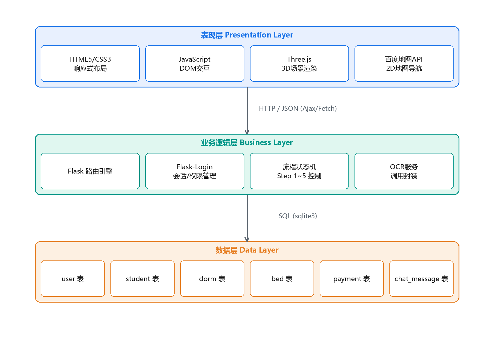
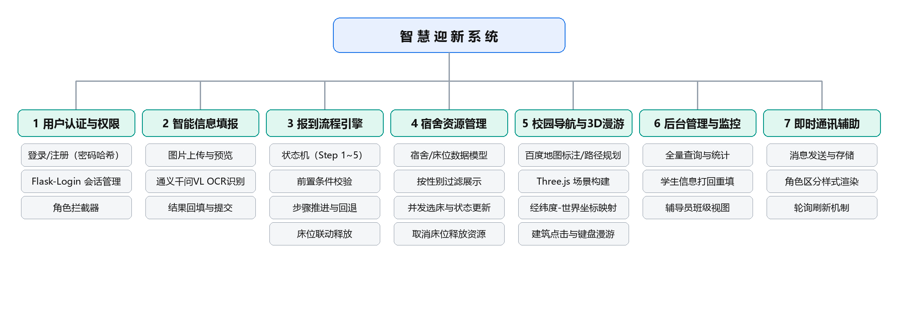
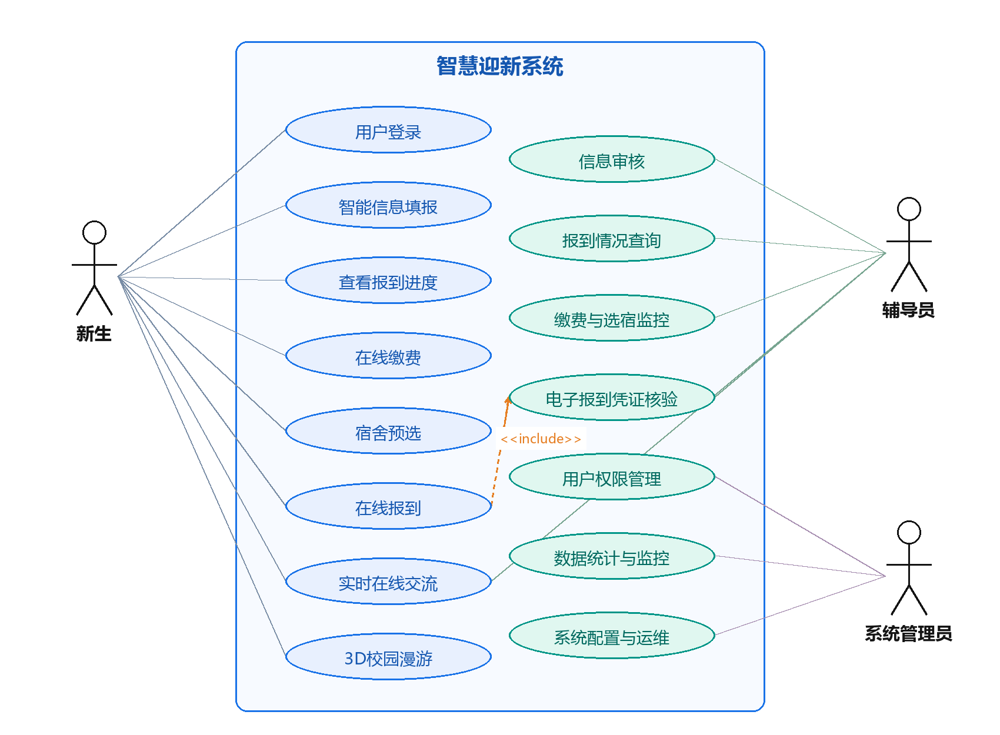

# 系统设计

本文档说明智慧迎新系统的总体架构、功能模块划分、报到流程状态机与关键实现思路，是 [`app.py`](../app.py) 与前端资源的设计依据。

## 1 设计目标与原则

系统围绕“一站式、智能化、可视化”三个目标展开设计：

- **一站式**：把身份核验、信息填报、宿舍分配、缴费确认等分散的窗口业务整合到统一的 Web 平台，新生在到校前即可完成大部分流程；
- **智能化**：用多模态大模型替代逐字段的手工录入，把证件图像直接转换为结构化档案；
- **可视化**：同时提供二维地图导航与三维校园漫游，帮助新生建立空间认知。

由此确定三条设计原则：

1. **业务规则集中在服务端**：前端按钮状态只作为易用性辅助，所有前置条件校验在服务端完成，避免绕过前端直接调用接口造成脏数据；
2. **状态与资源强绑定**：流程状态（`flow_step`）与床位占用、缴费记录联动，在同一个事务内提交，避免出现相互矛盾的状态组合；
3. **对第三方服务弱依赖**：识别接口配置缺失、超时或返回格式异常时均有降级方案，保证演示与填报流程不中断。

## 2 系统架构设计

系统采用三层 B/S 架构，自上而下依次为表现层、业务逻辑层与数据层。



### 2.1 表现层

- 常规管理页面由服务端 Jinja2 模板渲染，交互通过原生 JavaScript 与 `fetch` 发起；
- `static/js/three-scene.js` 在独立画布中构建三维校园场景，`OrbitControls` 提供视角旋转与缩放，`CSS2DRenderer` 叠加建筑文字标签；
- `templates/navigation.html` 使用百度地图 JavaScript API 渲染二维地图，支持驾车、步行、骑行三种路径规划；
- 公共导航栏（`templates/_navbar.html`）、消息提示与请求封装（`static/js/app.js`）被抽取复用，各业务页面只保留自身特有逻辑。

### 2.2 业务逻辑层

Flask 接收请求后按路由分发到处理函数，由处理函数完成流程校验、床位分配、权限判定与识别服务调用，结果统一以 JSON 返回。跨模块的状态变更（如选床同时影响床位表、学生表与流程步骤）在同一事务内完成。

### 2.3 数据层

数据层采用 SQLite，共 6 张核心业务表，分别保存用户账号、学生档案、宿舍、床位、缴费记录与聊天消息。应用层通过标准库 `sqlite3` 访问数据库，连接在操作结束后显式关闭，关键写操作通过 `conn.commit()` 提交。详见[数据库设计](数据库设计.md)。

## 3 功能模块设计





各模块在业务上相对独立，又通过共享的学生档案与流程状态相互关联：

| 模块 | 职责 | 关键实现位置 |
| --- | --- | --- |
| 用户认证与权限管理 | 为其余模块提供身份基础，区分学生 / 辅导员 / 管理员 | `load_user`、`admin_required`、`counselor_required` |
| 智能信息填报 | 把证件图像转换为结构化学生档案 | `call_dashscope_ocr`、`/api/ocr`、`/api/report` |
| 报到流程引擎 | 依据档案完整性、床位占用与缴费记录控制步骤流转 | `/api/report/status` |
| 宿舍资源管理 | 床位资源的分配与释放，为流程引擎提供数据 | `/api/dorms`、`/api/select_bed`、`/api/cancel_bed` |
| 校园导览 | 二维地图与三维场景，只读取校园地点数据 | `/api/navigation`、`/api/campus`、`three-scene.js` |
| 后台管理与监控 | 面向辅导员与管理员汇总数据并提供干预手段 | `/api/admin/*`、`/api/counselor/students` |
| 实时交流社区 | 为新生与管理人员提供沟通渠道 | `/api/chat/messages`、`/api/chat/send` |

## 4 接口设计约定

接口遵循三条约定：

1. **返回值结构统一**：均以 `{"success": 布尔值, "message": 说明文本}` 为外层结构，业务数据放在 `data`、`students`、`dorms` 等字段中，前端只需实现一套提示逻辑。
2. **校验分层**：参数格式校验在前端完成；业务合法性校验在服务端完成，涉及资源的操作（如选床）在服务端重新读取数据库状态，不依赖前端判断。
3. **权限集中**：除登录与注册外的接口统一由 `@login_required` 拦截，管理端与辅导员端接口再叠加角色装饰器，权限规则不分散在各处理函数内部。

接口清单与参数说明见 [API 接口文档](API接口.md)。

## 5 报到流程状态机

### 5.1 状态定义

报到过程被抽象为五个递进状态，对应 `student.flow_step` 取值 1~5：

```text
信息填报(1) ──▶ 资格审核(2) ──▶ 宿舍分配(3) ──▶ 缴费确认(4) ──▶ 报到完成(5)
     ▲                ▲                │
     └────────────────┴────────────────┘
           回退时自动释放已占用床位
```

采用单一整数字段而非多个标志位，主要出于三点考虑：

- 状态之间具有天然的先后顺序，可以避免出现“已缴费但未选床”这类矛盾组合；
- 资源操作与状态变更可以绑定在同一处逻辑中，例如从宿舍分配退回时自动释放床位；
- 前端可以根据当前状态决定按钮可用性，减少无效请求。

### 5.2 推进与回退的前置校验

接口首先判断目标步骤是否跨度过大，再针对具体步骤检查资源条件，最后在回退场景中释放资源：

```python
# 1. 禁止跳步
if new_step > current_step + 1:
    return jsonify({'success': False, 'message': '请按顺序完成步骤'}), 400

# 2. 进入宿舍分配阶段要求已绑定床位
if new_step == 3 and new_step > current_step:
    if not bed_row or not bed_row['bed_id']:
        return jsonify({'success': False, 'message': '请先选择宿舍'}), 400

# 3. 进入报到完成阶段要求已缴费
if new_step == 5 and new_step > current_step:
    if not pay_row or pay_row['status'] != 'paid':
        return jsonify({'success': False, 'message': '请先完成缴费'}), 400

# 4. 回退到步骤 <= 2 时释放床位
if new_step < current_step and new_step <= 2:
    if bed_row and bed_row['bed_id']:
        cursor.execute("UPDATE bed SET status='free', student_id=NULL WHERE id=?", (bed_row['bed_id'],))
        cursor.execute("UPDATE student SET bed_id=NULL, dorm_id=NULL WHERE student_id=?", (current_user.username,))
```

校验全部位于服务端，因此学生使用开发者工具直接调用接口也无法绕过前置条件；状态更新与资源释放在同一事务中提交，保证不会出现“状态已回退但床位仍被占用”的不一致状态。

## 6 关键实现

### 6.1 用户认证与角色权限拦截

口令在写入数据库前经 `generate_password_hash` 加盐哈希；每次请求由用户加载器重新读取数据库中的用户对象，使管理员在线调整角色后立即生效：

```python
@login_manager.user_loader
def load_user(user_id):
    conn = get_db_connection()
    cursor = conn.cursor()
    cursor.execute("SELECT id, username, role FROM user WHERE id = ?", (user_id,))
    row = cursor.fetchone()
    conn.close()
    if row:
        return User(row['id'], row['username'], row['role'])
    return None
```

在 `@login_required` 之上叠加角色装饰器实现分级授权：

```python
def admin_required(f):
    @wraps(f)
    def decorated(*args, **kwargs):
        if current_user.role != 'admin':
            abort(403)
        return f(*args, **kwargs)
    return decorated
```

### 6.2 多模态证件识别

识别流程分为图像采集与上传、二进制转 Base64、模型调用、结果解析与回填四个阶段。提示词中固定字段名称与 JSON 结构，降低模型输出多余文本的概率：

```python
prompt = """
请识别这张图片中的以下信息，以严格的JSON格式返回，不要包含任何其他文字：
{"name": "姓名", "id_card": "身份证号", "gender": "性别", "class_name": "班级",
 "major": "专业", "student_id": "学号", "contact": "联系电话"}
如果某项无法识别或不存在，请将该字段设为null。
"""

payload = {
    "model": "qwen-vl-plus",
    "input": {"messages": [{"role": "user", "content": [
        {"image": f"data:{mime};base64,{image_base64}"},
        {"text": prompt}]}]},
    "parameters": {"max_tokens": 1000},
}
response = requests.post(url, headers=headers, json=payload, timeout=30)
```

模型输出具有随机性，即使提示词要求只返回 JSON，返回文本中仍可能包含说明语句或代码块标记。因此在解析环节采用“定位 + 截取”策略，并保留降级路径：

```python
start, end = text.find("{"), text.rfind("}")
if start != -1 and end != -1 and end > start:
    ocr_data = json.loads(text[start:end + 1])
    return ocr_data
return None   # 上层切换为模拟数据，页面仍可手工填写
```

识别结果不会直接入库，而是先回填表单由新生核对。这样处理的原因有两点：一是模糊、反光或边角遮挡会导致字段错误，人工确认可以拦截大部分错误；二是身份证号、联系方式一旦写错会影响后续审核与缴费，入口处确认的成本低于事后修正。

### 6.3 宿舍与床位的数据组织

宿舍资源按楼栋、房间、床位三级组织，宿舍表保存楼栋、房间号与性别限制，床位表保存床位编号与占用状态，一个宿舍固定包含 4 个床位。前端先按当前学生性别调用 `/api/dorms` 获取符合条件的宿舍，再以卡片形式展示每个房间及床位状态（空闲 / 被他人占用 / 本人占用）。

床位表的 `status`、`student_id` 与学生表的 `bed_id`、`dorm_id` 之间存在冗余，用于提升查询效率，代价是任何占用或释放操作都必须同步更新两张表：

```python
cursor.execute("UPDATE bed SET status='occupied', student_id=? WHERE id=?", (student_id, bed_id))
cursor.execute("UPDATE student SET bed_id=?, dorm_id=?, flow_step=? WHERE student_id=?",
               (bed_id, bed['dorm_id'], next_step, student_id))
conn.commit()
```

### 6.4 并发选床的事务控制

浏览器的页面状态具有滞后性，仅在点击时依据页面显示判断床位是否空闲并不安全。服务端采用“二次校验 + 事务提交”策略：

```python
cursor.execute("SELECT * FROM bed WHERE id = ?", (bed_id,))
bed = cursor.fetchone()
if bed['status'] != 'free':
    return jsonify({'success': False, 'message': '该床位已被占用，请选择其他床位'}), 400

# 释放学生原有床位 -> 更新床位表 -> 更新学生表与流程步骤，同一事务提交
if old_bed_row and old_bed_row['bed_id'] and old_bed_row['bed_id'] != bed_id:
    cursor.execute("UPDATE bed SET status='free', student_id=NULL WHERE id=?", (old_bed_row['bed_id'],))
conn.commit()
```

SQLite 在写事务中对数据库文件加锁，两个并发事务不会同时进入写阶段：先到达的请求完成写入后，后到达的请求会在二次校验阶段读到已占用状态并被拒绝。该策略的代价是并发写操作需要排队，但在迎新场景的并发规模下可以接受；规模更大时可引入乐观锁版本号或迁移到支持行级锁的数据库。

### 6.5 校园导览

**二维地图**：页面初始化时创建地图实例并一次性获取全部地标数据，批量创建标注；用户可指定起点与终点，系统按所选出行方式调用对应路径规划服务并绘制路线，显示全程距离与预计耗时。三种出行方式共用同一套起终点界面，仅在调用服务时切换参数。

**三维场景**：按建筑类型生成差异化模型（校门采用门柱与横梁组合，教学楼与宿舍楼为带窗格的长方体，图书馆与体育馆体量更大），并布置地面、道路、中央喷泉、随机绿化与雾效。交互方面使用 `OrbitControls` 实现旋转缩放，监听 W/A/S/D 与方向键移动相机目标点，通过 `Raycaster` 实现建筑点击与高亮，通过 `CSS2DRenderer` 叠加始终面向屏幕的名称标签，并提供视角复位、路线开关、标签开关、昼夜切换、自动漫游与地点搜索。

**坐标映射**：场景中心不再写死，而是取全部地点经纬度的平均值，并按米制比例换算，解决了校园数据与场景中心不一致导致建筑偏移的问题：

```javascript
const latScale = 111320;
const lngScale = 111320 * Math.cos(center.lat * Math.PI / 180);
```

其中 `latScale` 表示 1 度纬度对应的米数，`lngScale` 依据中心纬度对经度方向的距离做余弦修正。Three.js 及其扩展库全部下载到 `static/js/vendor`，通过 importmap 从本地加载，避免外部 CDN 不可达导致场景空白；页面还提供加载中、加载失败与超时三种状态提示。

### 6.6 实时交流社区

所有已登录用户都可以发送文本消息，消息保存发送者用户名、角色、内容与时间。前端每 5 秒轮询消息接口，渲染时按角色使用不同气泡样式。聊天内容在存储与展示环节均做 HTML 转义，避免用户提交包含脚本标签的文本在他人浏览器中执行。

轮询方式开发成本低、兼容性好，不足是消息延迟受轮询间隔限制并产生一定无效请求；在迎新场景中聊天主要承担咨询与通知的辅助作用，因此选择了实现复杂度更低的方案。

### 6.7 工程化整理

- **前端结构统一**：导航栏抽取为公共模板，新增全局脚本统一提供消息提示、HTML 转义与请求封装，后台页面在移动端提供汉堡菜单；
- **业务一致性修复**：修复主面板宿舍信息不显示、辅导员按班级查询失败、更换床位时旧床位未释放、选择宿舍后流程被错误倒退等缺陷，这些问题的共同根源是同一份状态在多个位置被重复维护，修复时统一收敛到少数受控函数；
- **安全加固**：除登录与注册外的接口统一增加登录校验，管理与辅导员接口叠加角色校验，聊天内容统一转义；
- **三维场景改造**：依赖本地化 + 坐标动态计算，使场景在离线演示环境下也能稳定显示。

## 7 部署说明

```powershell
python -m venv .venv
.\.venv\Scripts\activate
pip install -r requirements.txt
python seed_data.py
python app.py
```

默认监听 `0.0.0.0:5000`。部署到公网前建议：

1. 通过环境变量或 `.env` 设置随机的 `SECRET_KEY`，并配置 `DASHSCOPE_API_KEY`、`BAIDU_MAP_AK`；
2. 使用 Waitress / Gunicorn 等生产级 WSGI 服务器替代 `app.run()`；
3. 将 SQLite 替换为 MySQL / PostgreSQL，并按业务规模拆分识别与聊天服务；
4. 关闭 debug，为管理端增加登录失败次数限制与操作审计。

## 8 后续扩展方向

- **支付渠道对接**：接入微信支付 / 支付宝校园服务接口，通过回调把支付结果写入缴费表，使流程推进与资金到账严格对应；
- **通信机制优化**：以 WebSocket 服务端推送替代轮询，降低消息延迟与无效请求；
- **识别能力增强**：增加端侧或服务端轻量识别模型作为补充，常见版式本地识别、复杂版面交给云端模型；
- **数据统计与决策支持**：增加报到实时大屏，展示各时段报到人数曲线、学院完成率排名与宿舍占用趋势。
